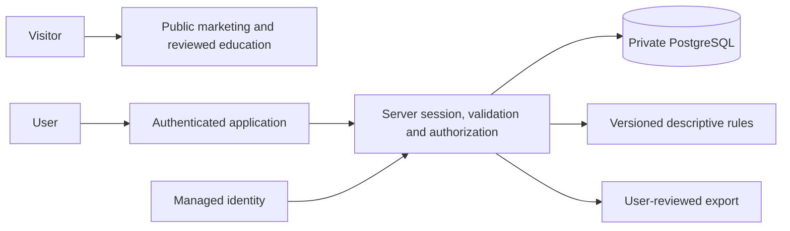

# Architecture

## Existing, verified functionality

Actual architecture: Git repository with `.gitattributes` only. No technology stack or application boundaries exist.

## Proposed functionality

Provisional recommendation: TypeScript + React/Next.js, server API/services, PostgreSQL and managed identity. A modular monolith limits operational overhead while preserving domain boundaries.

The diagram is proposed, not deployed. Public pages and private application need distinct layouts, bundles and cache policies. A separate marketing domain remains optional.

Data flow: browser submits over HTTPS; server verifies session, consent where applicable, payload and ownership; transaction saves; acknowledgement refreshes history. Rules read eligible owner-scoped records and return provenance. Exports use a bounded user-selected snapshot and preview. Edits/deletions invalidate dependent outputs.

Browser holds no server secrets. Identity provider authenticates; application authorizes; database remains private; reviewed publication workflow controls education. No advertising tracking in private routes. Record accepted architecture decisions with alternatives and tradeoffs before scaffolding.

## Decisions still needed

Stack approval, host/region, identity provider, same-origin API versus separate service, content storage, summary execution, availability target, age policy and data lifecycle.
